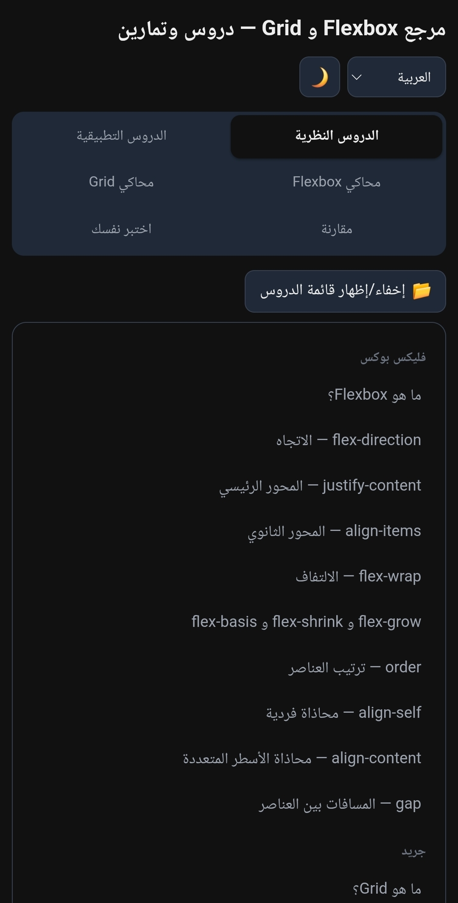
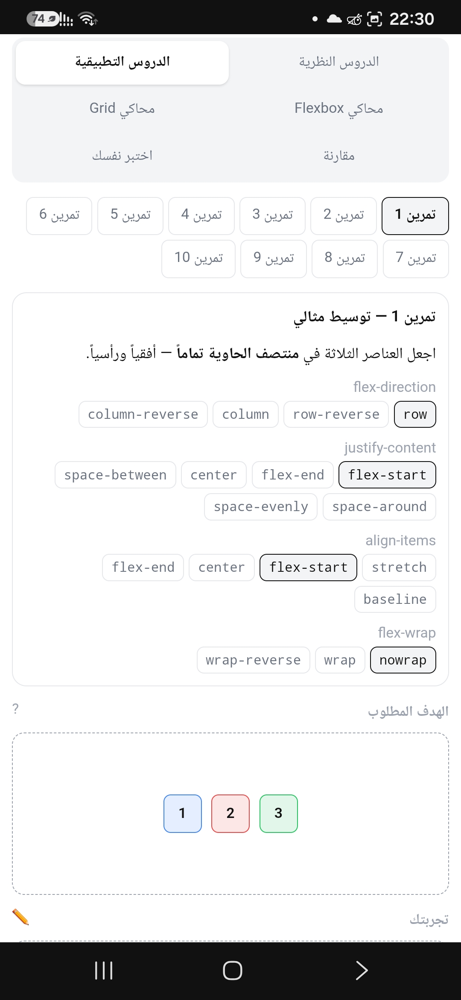
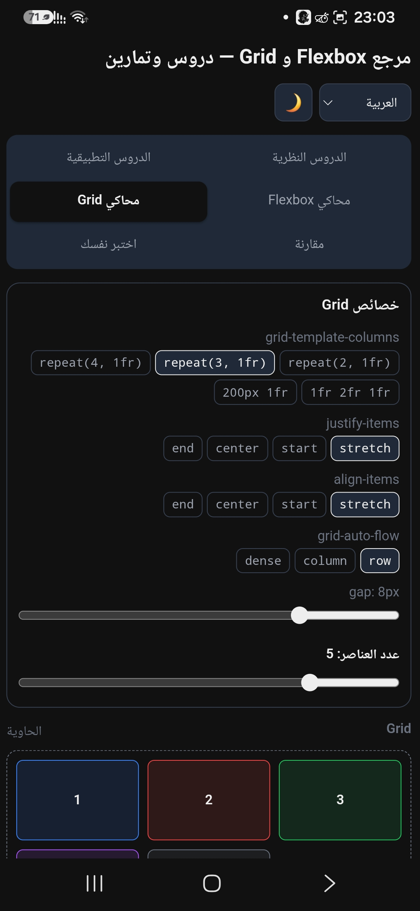
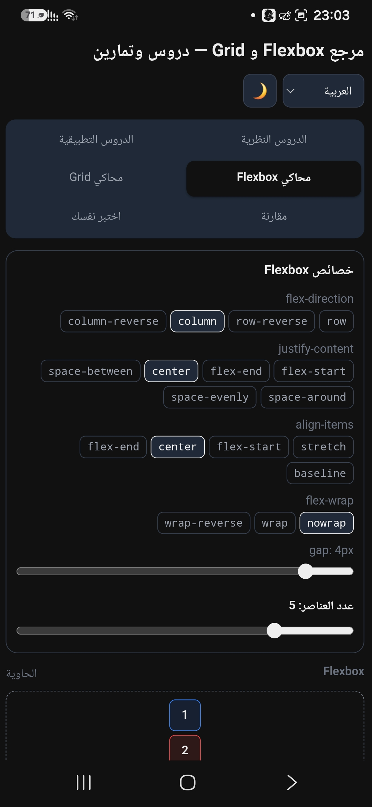
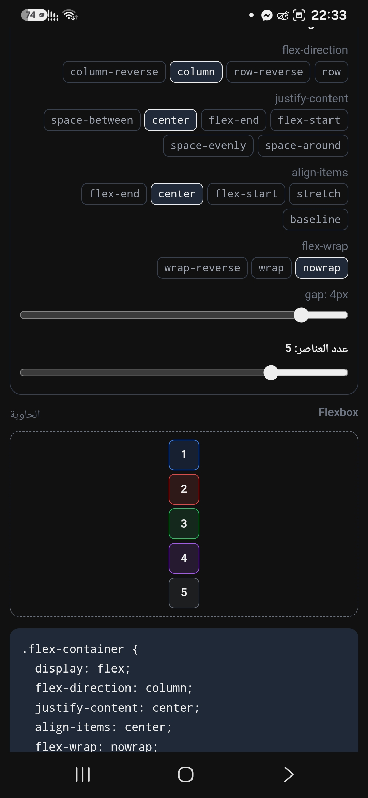

## 🌐 الرابط المباشر
[افتح التطبيق الآن](https://abdmou191.github.io/css-layout-master/)

## 📱 مميزات التطبيق
- ✅ **PWA**: يعمل دون إنترنت ويمكن تثبيته على الهاتف
- 🌍 **3 لغات**: العربية، الإنجليزية، الفرنسية
-  **الوضع الليلي**: مريح للعين
- 📚 **دروس شاملة**: Flexbox و CSS Grid
- 🎯 **تمارين تفاعلية**: مع حلول فورية
- 📊 **اختبارات**: لقياس مستوى فهمك
- 📱 **متجاوب**: يعمل على جميع الأجهزة

## 🚀 التقنيات المستخدمة
- HTML5
- CSS3 (Flexbox + Grid)
- Vanilla JavaScript
- Service Worker (PWA)
- localStorage

## 📸 لقطات شاشة






# 🎨 مرجع Flexbox و Grid — دروس وتمارين

تطبيق ويب تفاعلي لتعلم أنظمة التخطيط في CSS (Flexbox و CSS Grid) بطريقة عملية وممتعة.

## 🌟 المميزات

- 📚 **دروس نظرية شاملة**: تغطي جميع خصائص Flexbox و CSS Grid
- 🎯 **تمارين تطبيقية**: 10 تمارين تفاعلية لاختبار فهمك
- 🎮 **محاكي حر**: جرب الخصائص بنفسك وشاهد النتائج فوراً
- 📊 **اختبار ذاتي**: 10 أسئلة لقياس مستوى فهمك
- 🌍 **متعدد اللغات**: العربية، الإنجليزية، الفرنسية
- 🌙 **وضع ليلي**: مريح للعين أثناء الدراسة ليلاً
- 📱 **PWA**: قابل للتثبيت ويعمل دون اتصال بالإنترنت
- 🎨 **تصميم متجاوب**: يعمل على جميع الأجهزة

## 🚀 التثبيت والتشغيل

### الطريقة 1: فتح مباشر
1. قم بتنزيل المشروع أو استنساخه
2. افتح ملف `index.html` في المتصفح

### الطريقة 2: خادم محلي (موصى به)
```bash
# باستخدام Python 3
python -m http.server 8000

# باستخدام Node.js (http-server)
npx http-server -p 8000

# ثم افتح: http://localhost:8000
```

## 📁 هيكل المشروع
